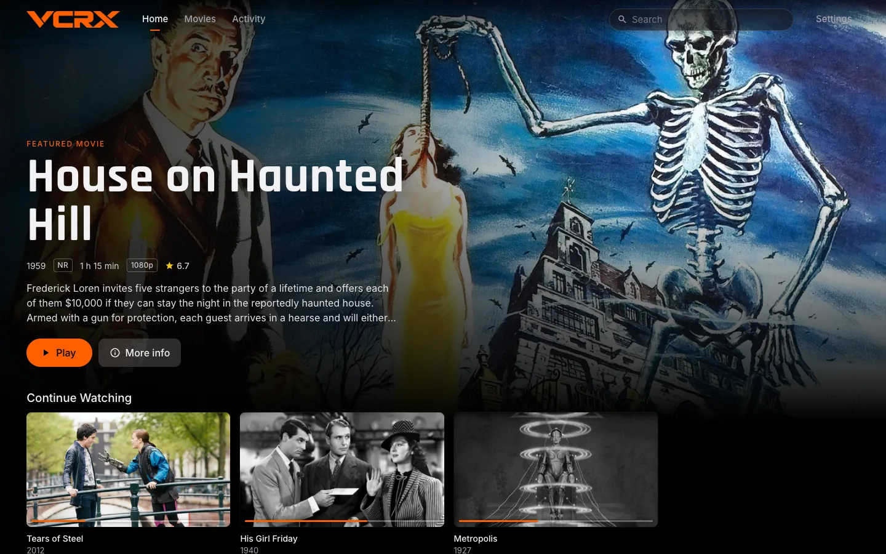
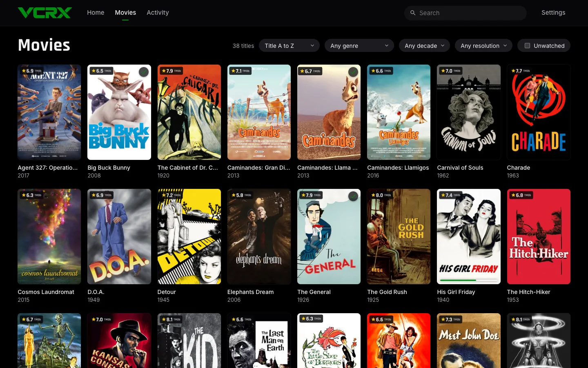
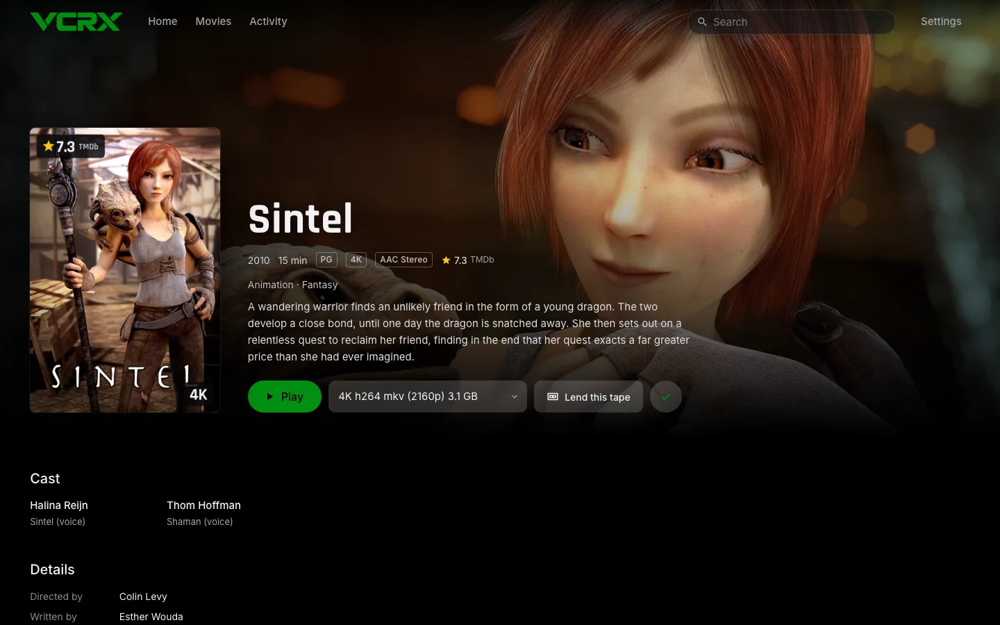
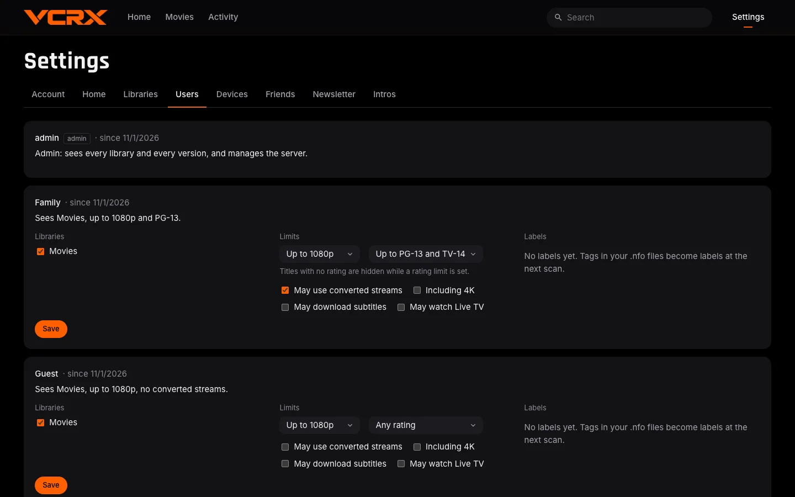

<p align="center"></p>

# VCRX Media Server

**Your media. Your hardware. Your rules.**

VCRX is a self-hosted media server with its own Google TV app, built from scratch. Point it at your movies, shows and music, and watch them in a browser or on your TV.

- **Nothing phones home.** No subscriptions, ads, telemetry or vendor accounts, and no required cloud service. It starts, scans and plays with the internet unplugged.
- **Access rules down to the file.** A friend can see the 1080p copy of a film and never the 4K one. Limit each person by library, resolution, content rating and label, and every route enforces it.
- **The add-ons are built in.** Activity history and stats, poster overlays, smart collections written as YAML files you own, Skip Intro, a weekly newsletter, and Radarr and Sonarr webhooks. No second program to run.
- **Share without accounts.** Invite a device with a link or a QR code, link a friend's VCRX server to yours, or lend one title for a few days. Everything streams; nothing is copied.

<table>
  <tr>
    <td></td>
    <td></td>
  </tr>
  <tr>
    <td></td>
    <td></td>
  </tr>
</table>

<sub>The web app with a demo library of <a href="https://studio.blender.org/films/">Blender Studio open movies</a> (CC BY) and US public-domain films. Artwork and plots from TMDb.</sub>

## What it does

| | |
|---|---|
| **Libraries** | Movies, TV and music. Incremental scans that trust your NFO files and local artwork first; TMDb and IMDb ratings if you want them. Automatic franchise collections. |
| **Playback** | Direct play whenever the device can. Otherwise the server converts on the fly: audio to AAC, video to H.264, HLS for Safari. Subtitles from the file, beside it, or OpenSubtitles. |
| **Home** | Rows built for each person: Continue Watching, Recently Added, Because You Watched, seasonal picks, Top Rated and more. Rearrange them and the layout follows you to the TV. |
| **Skip Intro and Credits** | Found overnight by matching each season's audio, or read from chapters and NFO markers. |
| **People** | Local accounts, household profiles with PINs, kids' profiles, invited devices, linked friends' servers. |
| **Activity** | Now playing, history, stats, stop a stream, webhooks and Discord messages. |
| **Music** | Albums and compilations from tags, live recordings with venue, source and checksums, gapless playback, a Music section on the TV. |
| **Live TV** (in progress) | Your own M3U playlists and XMLTV guides, with one shared pull per channel. |
| **Clients** | A web app built into the server, the Google TV app, and a REST API described by an OpenAPI 3.1 spec. |

Every feature in detail: [docs/FEATURES.md](docs/FEATURES.md).

## Status

Milestones 1 to 8 of [the plan](docs/PLAN.md) are done, plus the first parts of 9 and 10. There is no tagged release yet: `main` is what runs.

Still to come: online lists such as the IMDb Top 250, playlists, VA-API hardware acceleration, burned-in picture subtitles, setlists and tape trading, and TV platforms beyond Google TV.

## Quick start

You need Docker with Compose on a Linux host that can read your media.

```bash
git clone https://github.com/pete-builds/vcrx-media-server.git
cd vcrx-media-server/deploy
cp .env.example .env                       # set VCRX_MOVIES_DIR and VCRX_TV_DIR
mkdir -p data/config data/cache
cp vcrx.example.yaml data/config/vcrx.yaml # declares the Movies and TV libraries
docker compose up -d --build
docker compose exec vcrx vcrx user add -username you -admin
docker compose logs -f vcrx                # watch the first scan
```

Then open `http://<server-ip>:3750/` in a browser and sign in. Your media is mounted read-only, so VCRX never changes it, and any other media server on the same host keeps running untouched.

**On the TV:** build the APK with one command and sideload it with ADB, as [tv/README.md](tv/README.md) describes, then enter `http://<server-ip>:3750` and sign in.

Adding users, backups, updates and the optional services (TMDb, OpenSubtitles, Radarr and Sonarr): [docs/INSTALL.md](docs/INSTALL.md).

## Documentation

| Guide | What it covers |
|---|---|
| [Installing and running](docs/INSTALL.md) | Setup, users and access, the CLI, configuration, backups and restore, updating, optional services |
| [Features](docs/FEATURES.md) | The web app, playback, Home, music, collections, overlays, trailers, Skip Intro, activity and notifications |
| [Security and privacy](docs/SECURITY-AND-PRIVACY.md) | Sign-in, invites, linked servers, and exactly what leaves your network |
| [Internet access](docs/INTERNET-ACCESS.md) | Reaching VCRX from outside your home through Caddy |
| [Playback compatibility](docs/PLAYBACK-COMPATIBILITY.md) | What happens to each kind of file on each kind of client, and what has been tested |
| [TV app](tv/README.md) | Building, installing and using the Google TV app |
| [Development](docs/DEVELOPMENT.md) | Building and testing the server and the web app |

## Security and privacy in brief

- **LAN first.** Never forward port 3750 on your router. For access from outside, follow the [internet access guide](docs/INTERNET-ACCESS.md) or use a VPN. Admin routes answer only from your own network unless you allow otherwise.
- **Locked down by default.** Passwords and PINs are hashed with argon2id, tokens and invites are stored only as hashes, and sign-in attempts are rate limited.
- **Quiet.** No telemetry, usage reports or update checks. VCRX contacts TMDb, OpenSubtitles or YouTube only if you turn them on, and who watched what stays in your own database.

## Licence

AGPL-3.0-or-later. If you run a modified VCRX as a service, share your changes.

This product uses the TMDB API but is not endorsed or certified by TMDB. The VCRX name and artwork live in [brand/](brand/README.md).
